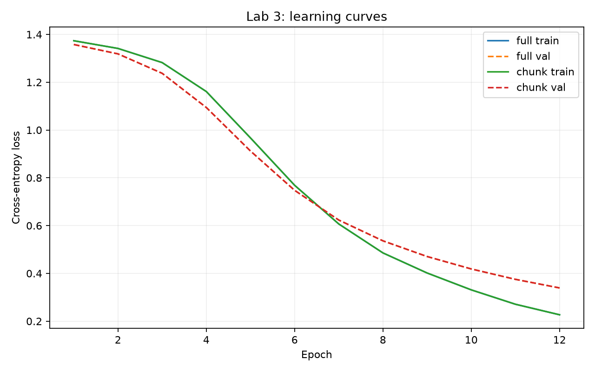

# Лабораторная работа № 3

**Тема:** Пайплайн DL-модели: полный датасет и чанки

**Вариант:** 18
**Автор:** София Валиева
**Дата:** 16.10.2026
**Коммит реализации кода:** `47a5dfde2a223ef54694b69a548a9f3cad344a6c`
**Датасет:** 20 Newsgroups, 4 класса

## 1. Цель и режим воспроизводимости

Реализовать и сравнить обучение одной нейросетевой архитектуры при загрузке полного датасета в память (Full) и потоковом чтении чанков с диска (Chunk).

**Объявленный режим совпадения прогонов — точный:** при фиксированном seed и детерминированных операциях должны совпасть метрики и веса модели. Критерий указан здесь перед таблицами результатов; проверка реализована в `src/lab3/verify_lab3.py`.

## 2. Данные и контрольные суммы

- Обучающий источник: `data/raw/train.jsonl`; SHA256: `133fe0f80172b63eea19367082a01206a376f47f1ddc5f17e4c1e54be6aba50e`.
- Тестовый источник: `data/raw/test.jsonl`; SHA256: `a48bce77e2ead08fdfd91a9a321fc301ca36958f4275aac55aa8a5ce6a6f3cf3`.
- Обучающая/валидационная выборки: 1,624 / 410 документов; тест: 1,353 документа (`src/lab3/text_data.py`, `src/lab3/make_report.py`).
- Словарь формируется **только по обучающей части**, без валидационных и тестовых текстов (`src/lab3/text_data.py`).

## 3. Архитектура и параметры

- Архитектура: `embeddingbag_mlp`; `EmbeddingBag(mode=mean) → Linear → ReLU → Dropout → Linear` (`src/lab3/network.py`).
- Число параметров: **1,141,188** (`reports/LAB3/dl_model.pt`, `src/lab3/make_report.py`).
- Размер словаря: 17,762; embedding_dim=64; hidden_dim=64; dropout=0.2.
- Batch size=64; максимум эпох=12; learning rate=0.001; оптимизатор AdamW; loss CrossEntropyLoss.
- Seed=42; patience ранней остановки=3; критерий — минимум validation loss.
- Chunk size=256; потоковый `IterableDataset` считывает JSONL с диска блоками без хранения всего корпуса (`src/lab3/train.py`, `src/lab3/text_data.py`).
- Обучение выполнялось на CPU для детерминированности; паритет с MPS проверен отдельно.
- Конфигурация валидируется Pydantic: `configs/lab3.yaml`.

## 4. Кривые обучения и ранняя остановка

Кривые `train_loss`, `val_loss`, `train_macro_f1`, `val_macro_f1` записаны по эпохам в `training_history_full.csv` и `training_history_chunk.csv`; построены `python -m src.lab3.plot_training`.

- **Full:** 12 эпох; лучшая эпоха 12; ранняя остановка не сработала (максимум эпох достигнут)
- **Chunk:** 12 эпох; лучшая эпоха 12; ранняя остановка не сработала (максимум эпох достигнут)

## 5. Качество на тесте

95%-е бутстрэп-интервалы: `src/lab3/train.py` (300 повторов).

| Метрика | Full: значение [95% ДИ] | Chunk: значение [95% ДИ] |
|---|---:|---:|
| Accuracy | 0.7945 [0.7742; 0.8164] | 0.7945 [0.7742; 0.8164] |
| Macro F1 | 0.7712 [0.7494; 0.7934] | 0.7712 [0.7494; 0.7934] |
| Macro Precision | 0.7722 [0.7505; 0.7951] | 0.7722 [0.7505; 0.7951] |
| Macro Recall | 0.7719 [0.7509; 0.7942] | 0.7719 [0.7509; 0.7942] |
| Recall редкого класса | 0.6096 [0.5399; 0.6667] | 0.6096 [0.5399; 0.6667] |

Редкий класс определяется по частотам train: **3** (`src/lab3/train.py`, поле `rare_class` чекпоинта).
Все метрики связаны с MLflow через `reports/LAB3/dl_metrics.csv`.

## 6. Сравнение времени и памяти

| Показатель | Full | Chunk |
|---|---:|---:|
| Время обучения, с | 2.950 | 6.059 |
| Пиковая память процесса, МБ | 511.88 | 539.27 |
| Эпохи | 12 | 12 |
| Лучшая эпоха | 12 | 12 |

Источник: `reports/LAB3/memory_compare.csv`, измерения в отдельных процессах (`src/lab3/train.py`).

На данном небольшом датасете Chunk не продемонстрировал экономии пиковой памяти процесса и оказался медленнее Full. Это не противоречит ограниченности памяти *самого потокового чтения*: общий RSS включает PyTorch, модель, оптимизатор и накладные расходы.

## 7. Воспроизводимость и негативные контроли

| Проверка | Значение / результат |
|---|---|
| Seed | 42 |
| Число повторных обучений | 2 |
| Macro F1 двух повторов | 0.771188 / 0.771188 |
| Разница истории эпох | 0.0 |
| Разница весов повторов | 0.0 |
| Разница весов Full/Chunk | 0.0 |
| Отсутствующий seed отклоняется | True |
| Нулевой batch size отклоняется | True |
| Инициализации без повторной фиксации seed различаются | True |

Источник: `reports/LAB3/verification_results.json` (`python -m src.lab3.verify_lab3`). Негативный контроль без повторной фиксации seed показывает разницу начальных весов, а не полный повтор обучения без seed.

### Масштабирование потокового чтения

| Источник, записей | Пик Python-аллокаций при чтении, МБ |
|---:|---:|
| 1000 | 0.21487 |
| 10000 | 0.22187 |

Измерено через `tracemalloc` в `src/lab3/verify_lab3.py`. Это память Python-аллокаций во время потокового чтения, а не общий пик RSS процесса. Источник увеличен в 10 раз; память загрузчика практически не изменилась.

### Паритет CPU/MPS

| Устройства | Макс. абсолютное расхождение логитов | Допуск | Результат |
|---|---:|---:|---|
| CPU / MPS | 4.768371582e-07 | 1e-05 | PASS |

Паритет измерен на одном и том же сохранённом чекпоинте и тестовом батче, `float32`; источник: `reports/LAB3/verification_results.json`.

## 8. MLflow, чекпоинты и хеши

| Режим | MLflow Run ID | Чекпоинт | SHA256 |
|---|---|---|---|
| Full | `edfdb4e51444458d9e850a7e79fbf332` | `reports/LAB3/dl_model.pt` | `b093ddf5057e9633e3c2625673eedd9836f86800c8ab210a4131adc7aebcd2e9` |
| Chunk | `b949341c13f84ef89ffb5213e0cc1de4` | `reports/LAB3/dl_model_chunk.pt` | `bee4a1135d7544cbb43c0d021f22856dfa721a2c30f437efca431c0b3fd3e78f` |

MLflow хранится локально в `mlflow.db` (SQLite; файл не коммитится). Run ID сверены с локальной базой при генерации отчёта (`src/lab3/make_report.py`).

## 9. Сравнение с классической моделью ЛР2

| Модель | Full Macro F1 | Chunk Macro F1 |
|---|---:|---:|
| ЛР2: HashingVectorizer + SGDClassifier | 0.8605 | 0.8629 |
| ЛР3: EmbeddingBag + MLP | 0.7712 | 0.7712 |

Источник: `reports/LAB2/ml_metrics.csv` и `reports/LAB3/dl_metrics.csv`. Классическая модель ЛР2 оказалась точнее на текущем разбиении. Сравнение следует трактовать с оговоркой: процедуры обучения и выделения валидации у лабораторных работ различаются.

## 10. Ограничения и выводы

1. Full и Chunk обучили одну архитектуру с одинаковыми параметрами, показали одинаковое качество и идентичные веса.
2. Воспроизводимость при фиксированном seed подтверждена двумя повторными обучениями; паритет CPU/MPS укладывается в допуск.
3. Chunk обеспечивает потоковое чтение с ограниченным буфером, но на этом датасете не уменьшил общий пик RSS и увеличил время обучения.
4. Качество нейросети ниже классического ML-базиса ЛР2; возможные улучшения — предобученные эмбеддинги, настройка архитектуры и регуляризации, увеличение числа эпох с контролем по валидации.
5. Негативный контроль отсутствия повторной фиксации seed проверяет инициализацию весов, но не весь цикл обучения; это ограничение эксперимента.

## 11. Основные артефакты

- `configs/lab3.yaml` — конфигурация Pydantic.
- `src/lab3/` — код загрузчиков, модели, обучения и проверок.
- `dl_metrics.csv` — метрики с бутстрэп-интервалами и MLflow Run ID.
- `memory_compare.csv` — память и время двух режимов.
- `training_history_full.csv`, `training_history_chunk.csv` — кривые по эпохам.
- `learning_curves.png` — визуализация кривых.
- `dl_model.pt`, `dl_model_chunk.pt` — чекпоинты.
- `training_run_full.json`, `training_run_chunk.json` — метаданные прогонов.
- `verification_results.json` — проверки воспроизводимости, негативных контролей, памяти и устройств.
