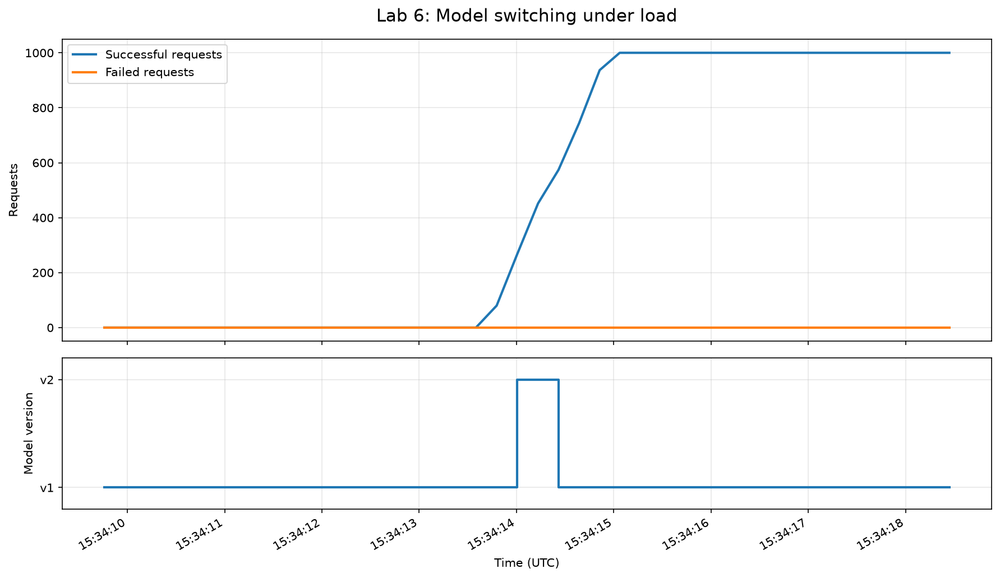

# Лабораторная работа № 6. FastAPI-сервис модели с бесшовным переключением

## 1. Общие сведения

| Поле | Значение |
|---|---|
| Автор | Мельникова София Рафаэлевна |
| Вариант | 18 |
| Дата итогового испытания | 28.10.2026 |
| Git-ветка | `feature/lab6` |
| Git-коммит на момент испытания | `77862e5` (до фиксации итоговых изменений ЛР6; обновить после коммита) |
| Модальность | Классификация текстов, корпус 20 Newsgroups |
| Среда | macOS, Python 3.12, FastAPI, PyTorch, pytest |
| Хеш исходного набора данных | Не зафиксирован в предоставленных результатах; при наличии взять из отчётов предыдущих ЛР |

## 2. Цель и постановка задачи

Цель работы — реализовать сервис инференса обученной текстовой модели на FastAPI с валидацией входных данных, реестром версий, контролем целостности артефактов, переключением рабочей версии без перезапуска сервера и откатом. Дополнительно требуются контрактные и негативные тесты, проверка переключения под параллельной нагрузкой и отдельный сервис мониторинга с журналом и графиком.

Критерии нагрузочного испытания: доля успешных запросов не ниже 99,9 %, отсутствие потерянных запросов, фиксация успешных операций `promote` и `rollback`.

## 3. Архитектура решения

Решение состоит из двух независимо запускаемых HTTP-сервисов:

1. **Сервис инференса**, `src/lab6/service.py`, порт `8000`: принимает тексты, возвращает предсказания, управляет версиями и предоставляет метрики.
2. **Сервис мониторинга**, `src/lab6/monitoring.py`, порт `8001`: периодически обращается к `/metrics` и `/models`, сохраняет временной ряд в CSV, журналирует события реестра и формирует PNG-график.

Основные компоненты:

| Файл | Назначение |
|---|---|
| `src/lab6/model_loader.py` | Проверка SHA256, загрузка контрольной точки PyTorch, восстановление модели и предсказание |
| `src/lab6/init_registry.py` | Первичная регистрация версий |
| `src/lab6/registry.py` | Состояния моделей, активная версия, история, операции продвижения и отката |
| `src/lab6/schemas.py` | Контракты запросов и ответов Pydantic |
| `src/lab6/service.py` | API инференса, метрики инференса и HTTP-статусов |
| `src/lab6/monitoring.py` | Независимый сбор метрик, текстовые события и график |
| `src/lab6/load_test.py` | Параллельные HTTP-запросы и переключение моделей под нагрузкой |
| `tests/lab6/test_contracts.py` | Автоматические контрактные и негативные проверки |

В обработчике `/predict` ссылка на текущий объект модели получается **один раз до выполнения инференса**. Переключение меняет ссылку на активную модель для следующих запросов; уже выполняющийся запрос продолжает использовать ранее полученный объект. Реестр синхронизирует операции изменения состояния и сохраняет JSON через замену временного файла. Реализация проверена в конфигурации **одного процесса Uvicorn**; согласованность между несколькими процессами или узлами не исследовалась.

## 4. Реестр моделей и контроль целостности

Реестр: `reports/LAB6/registry.json`. На момент итоговой проверки он содержит две версии и **10 событий истории**.

| Версия | Артефакт | SHA256 | Состояние после теста |
|---|---|---|---|
| `v1` | `reports/LAB3/dl_model.pt` | `b093ddf5057e9633e3c2625673eedd9836f86800c8ab210a4131adc7aebcd2e9` | `working` |
| `v2` | `reports/LAB3/dl_model_chunk.pt` | `bee4a1135d7544cbb43c0d021f22856dfa721a2c30f437efca431c0b3fd3e78f` | `canary` |

Активная версия после нагрузочного теста — `v1`. В реестре предусмотрены состояния подготовки, канареечной, рабочей и выведенной из эксплуатации версии. При загрузке проверяется соответствие SHA256 ожидаемому значению; контрольный тест с подменённым хешем подтверждает отказ в загрузке.

**Ограничение сравнения версий:** файлы контрольных точек имеют разные SHA256 и отличаются метаданными/режимом сохранения, однако ранее выполненная проверка `torch.equal` показала идентичность весов нейросети. Следовательно, эксперимент доказывает переключение между двумя зарегистрированными артефактами и непрерывность обслуживания, **но не изменение качества классификации** при смене версии. Численные метрики качества моделей доступны в данных реестра и результатах ЛР3; без дополнительного измерения нельзя утверждать превосходство одной версии.

## 5. HTTP API и валидация

| Метод | Маршрут | Назначение | Проверяемые ответы |
|---|---|---|---|
| GET | `/health` | Состояние сервиса и активная версия | `200` |
| POST | `/predict` | Классификация текста | `200`, `422` |
| GET | `/metrics` | Метрики инференса и HTTP-запросов | `200` |
| GET | `/models` | Реестр версий и история | `200` |
| POST | `/promote` | Перевод выбранной версии в рабочую | `200`, `404`, `409`, `422` |
| POST | `/rollback` | Возврат к предыдущей версии | `200`, `409` |

Запрос `/predict` содержит строковое поле `text`: обязательное, непустое, длиной не более 20 000 символов; строка только из пробелов и лишние поля отклоняются. Ответ содержит `version`, `predicted_class`, `confidence`. Pydantic возвращает описательный HTTP `422` при нарушении контракта.

В сервисе отдельно ведутся:

- метрики **инференса**: `predict_requests_total`, `predict_successful`, `predict_failed`, `average_predict_latency_ms`;
- метрики **HTTP**: `http_requests_total`, `http_status_counts`, `http_validation_errors_422`, `http_server_errors_5xx`, `http_average_latency_ms`.

Проверка некорректного запроса `{"text":123}` вернула HTTP `422` с сообщением `Input should be a valid string`. Снимок `/metrics` после проверки: `http_validation_errors_422=1`, `http_server_errors_5xx=0`, `predict_requests_total=0`. Это подтверждает, что отклонённый Pydantic запрос не попал в обработчик модели. Общий HTTP-счётчик включал обращения мониторинга.

## 6. Контрактные и негативные тесты

Команда:

```bash
python -m pytest tests/lab6/test_contracts.py -v
```

**Фактический результат:** `18 passed in 6.63s` (28.10.2026). Протокол: `reports/LAB6/service_tests.log`.

Проверены успешный запрос классификации, обязательность и тип поля `text`, пустые и пробельные строки, превышение допустимой длины, запрет лишних полей, структура `/models`, метрики, успешные продвижение и откат, неизвестная версия (`404`), повторное продвижение активной версии (`409`), откат без предыдущего продвижения (`409`), отсутствие обязательного поля в запросе продвижения (`422`), неверный SHA256 и отдельный учёт HTTP-кодов `200`, `404`, `422`.

Дополнительный контрактный тест выполняет **по 100 обращений к каждому из шести маршрутов** (в сумме 600 обращений) с предусмотренными допустимыми ответами.

## 7. Нагрузочное испытание и бесшовное переключение

Финальное испытание проведено **28.10.2026 в 15:34 UTC** с помощью `src/lab6/load_test.py`. Использовались настоящий HTTP-сервер `127.0.0.1:8000`, пул из **8 потоков** и **1 000 запросов** к `/predict`. Во время выполнения после получения 100 результатов выполнено `/promote` (`v1 → v2`), после 500 — `/rollback` (`v2 → v1`).

| Показатель | Фактическое значение |
|---|---:|
| Отправлено запросов | 1 000 |
| Получено результатов | 1 000 |
| Успешных запросов | 1 000 |
| Неуспешных запросов | 0 |
| Потерянных запросов | 0 |
| Успешность | **100,000 %** |
| Длительность | 1,226 с |
| Пропускная способность | 815,546 запроса/с |
| P95 задержки | 12,536 мс |
| Ответов с версией `v1` | 603 |
| Ответов с версией `v2` | 397 |
| Итоговая активная версия | `v1` |

Оба управляющих HTTP-запроса завершились успешно, перезапуск Uvicorn между ними не выполнялся. Наличие ответов обеих версий подтверждает фактическое обслуживание запросов до и после переключения. Доля успешных запросов превысила порог 99,9 %, потерь не зафиксировано.

Показатель P95 рассчитан по временам выполнения клиентских запросов в данном прогоне. Результаты относятся к конкретному локальному запуску и не характеризуют гарантированную производительность при других нагрузках и конфигурациях.

Машиночитаемые результаты: `reports/LAB6/load_test.json`.

## 8. Независимый мониторинг

Сервис мониторинга работает отдельно на порту `8001`. Он опрашивает основной API, сохраняет выборки в `reports/LAB6/monitoring_samples.csv`, пишет события и ошибки в `reports/LAB6/monitoring.log`, строит график `reports/LAB6/monitoring_chart.png`.

Журнал зафиксировал события `MODEL_EVENT` для `promote` и `rollback`, а также изменения активной версии `v1 → v2 → v1`. При временной остановке основного API мониторинг возвращал `degraded` и записывал `Connection refused`; после восстановления соединения возобновил сбор данных. Эти ошибки доступности происходили отдельно от успешного финального нагрузочного прогона.



*Рисунок 1 — график мониторинга. Перед сдачей обновить PNG через `GET http://127.0.0.1:8001/chart`, чтобы изображение соответствовало финальному прогону 28.10.2026.*

Поскольку счётчики инференса находятся в оперативной памяти, при перезапуске основного сервиса они обнуляются. Для корректной интерпретации графика используется окно вокруг последнего периода работы `v2`; архивный CSV при этом может содержать измерения нескольких запусков.

## 9. Воспроизводимость

Из корня репозитория, в активированном виртуальном окружении Python 3.12:

```bash
# Терминал 1: основной API
python -m uvicorn src.lab6.service:app --host 127.0.0.1 --port 8000

# Терминал 2: независимый мониторинг
python -m uvicorn src.lab6.monitoring:app --host 127.0.0.1 --port 8001

# Терминал 3: контрактные проверки
python -m pytest tests/lab6/test_contracts.py -v

# Терминал 3: нагрузочный тест; начинать с активной v1
python -m src.lab6.load_test

# Терминал 3: обновление графика
curl -f http://127.0.0.1:8001/chart -o reports/LAB6/monitoring_chart.png
```

API-документация: `http://127.0.0.1:8000/docs` и `http://127.0.0.1:8001/docs`.

Для воспроизведения требуются зависимости проекта, включая FastAPI, PyTorch, Pydantic, pytest, библиотеку тестового клиента, matplotlib, а также файлы моделей из ЛР3. **Перед сдачей следует проверить, что фактически используемая библиотека тестового клиента добавлена в зависимости проекта.**

## 10. Использование ИИ и самостоятельная проверка

ИИ-ассистент использовался для проектирования структуры FastAPI-сервиса, примеров кода реестра и мониторинга, составления контрактных и нагрузочных тестов, диагностики ошибок запуска и оформления отчёта. Автор самостоятельно запускала код в локальном окружении, проверяла HTTP-ответы, исправляла синтаксическую ошибку теста, повторяла испытания после изменений, анализировала график и фиксировала реальные показатели. Выводы о надёжности ограничены наблюдаемыми результатами тестов.

## 11. Выводы и ограничения

Разработан FastAPI-сервис классификации текстов с двумя зарегистрированными артефактами модели, контролем SHA256, контрактами Pydantic, переключением и откатом без перезапуска в одном процессе сервера. Все **18 автоматических тестов** прошли успешно. При финальном испытании **1 000 из 1 000** запросов обработаны успешно; потерь нет, P95 составляет **12,536 мс**. Отдельный мониторинг зарегистрировал операции смены версии и собрал временной ряд метрик.

Основные ограничения: одинаковые веса в двух артефактах, отсутствие испытаний нескольких процессов/узлов и персистентного хранилища HTTP-счётчиков; показатели производительности относятся к локальному прогону. Для промышленного использования потребовались бы многопроцессная координация, централизованная телеметрия и испытания на различных уровнях нагрузки.

## 12. Артефакты сдачи

| Артефакт | Путь |
|---|---|
| Итоговый отчёт | `reports/LAB6/lab6_report.md` |
| Журнал тестов | `reports/LAB6/service_tests.log` |
| Реестр моделей и история | `reports/LAB6/registry.json` |
| Результаты нагрузки | `reports/LAB6/load_test.json` |
| Текстовый журнал мониторинга | `reports/LAB6/monitoring.log` |
| Временной ряд мониторинга | `reports/LAB6/monitoring_samples.csv` |
| График мониторинга | `reports/LAB6/monitoring_chart.png` |
| Код сервиса и тестов | `src/lab6/`, `tests/lab6/` |

**Перед отправкой:** обновить график, уточнить хеш исходных данных по предыдущим работам (если он обязателен), зафиксировать зависимости, выполнить финальные проверки репозитория и заменить в шапке коммит на хеш итоговой фиксации.
